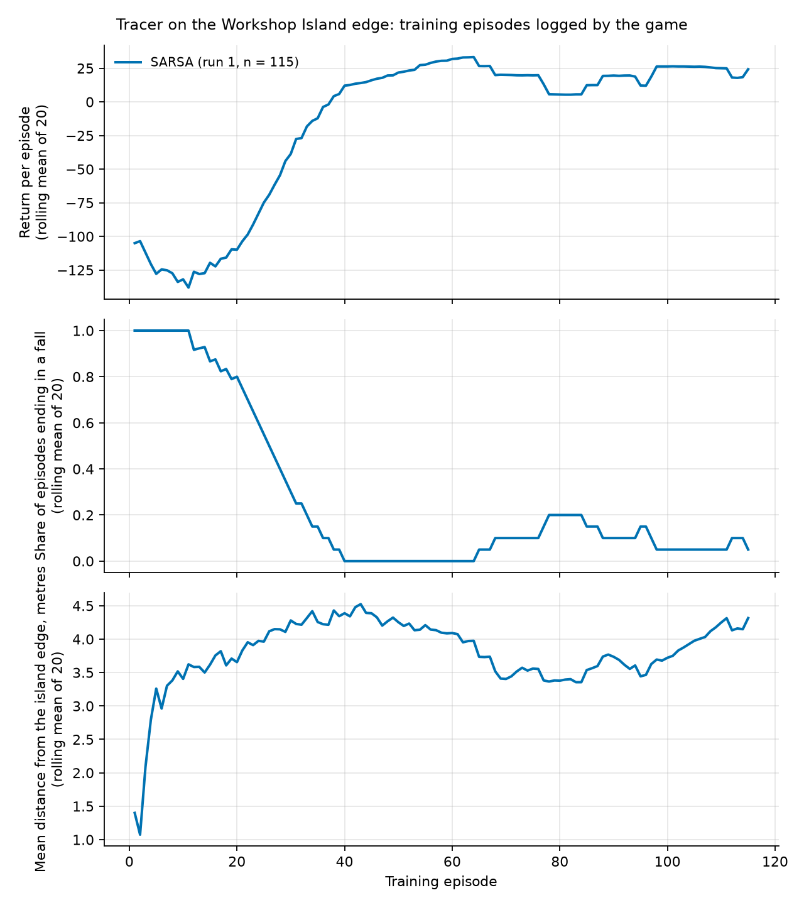
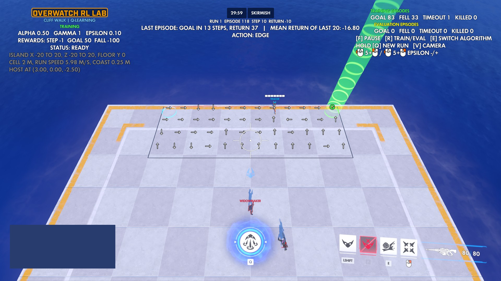
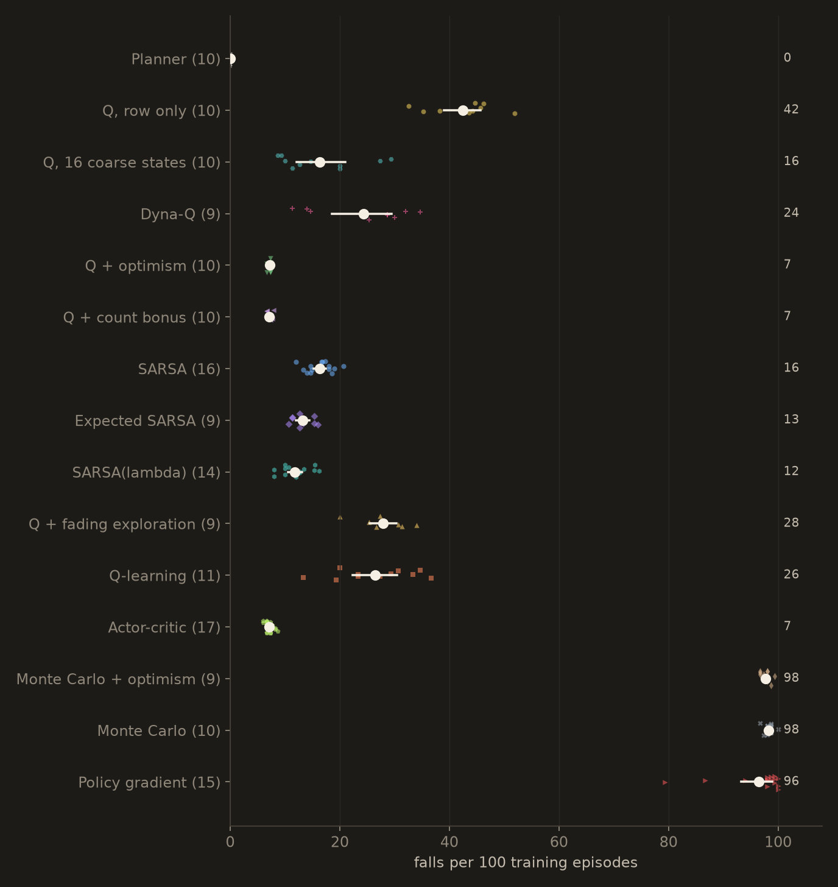

# Overwatch RL Lab

Reinforcement learning experiments that run inside the real Overwatch 2, on Workshop Island.
A Tracer bot learns to cross a strip along the island's edge by trial and error. A wrong step
sends her off the island for real, and the game's own physics decide what each move does.
You watch the policy form as arrows on the floor, switch between SARSA and Q-learning, and take
the logs out for analysis.

The experiments are not simulated. All movement, falling, shooting and dying happen in the
game, driven by an official Workshop script. Python is used only to read the game's log files.
(One small rules-only simulator was added for lesson 11, to predict a result before the game was
asked. It is labelled wherever its numbers appear.)


*A real screenshot (Overwatch 2.25.1.0, 2026-11-21). The red line is the island's edge. Arrows are
the action Tracer currently rates best in each cell; dots are cells she has not learned about.*


<!-- day2:start -->
## The course, and a wall she cannot see

**The course.** David Silver's ten lectures were transcribed in full and gone through in his order, each idea followed
by the same idea on the strip with what the bots did: [course/](course/README.md) (7 of 10 written so far), with
an outline per lecture for a video series in [series/](series/README.md). Lecture transcripts are not in this
repository; the pages are re-explanations with time stamps into the videos.

**Lesson 11: partial observability.** One square on the runner's way is shut, a different one each episode, and she is
not told which. Three Q-learning runners differ only in what they are given: her square; her square and a memory of
the bump; her square and the wall. Measures and comparisons were committed before each design ran
([docs](docs/night-school.md)), and a rules-only simulator (`node analysis/sim/hidden_wall_sim.js`) gave the prediction
for the second design before the game did.

- Short strip, wall in any of four rows, no way round (3, 4 and 3 runs): test crossings reaching the goal were 52% for the runner told only her square, 100% for the one who also remembers a bump, 87% for the one shown the wall. Remembering against blind: +48 points (95% interval 20 to 100, shuffle probability 0.029), a real difference by the rule set in advance.
- Long strip, wall in one of two rows, a way round exists (3, 4 and 3 runs): test crossings reaching the goal were 67% for the runner told only her square, 50% for the one who also remembers a bump, 50% for the one shown the wall. Remembering against blind: -17 points (95% interval -75 to 50, shuffle probability 1.000), inconclusive by the rule set in advance.

The same three conditions on a local language model (`llm/hidden_order.py`, a small support task where the exact
belief after every message is known):

- gemma4:12b, 24 cases per condition: right final step in 6 with only the latest message (18 never finished), 23 with its own notes, 24 with the whole transcript, 24 when told the hidden facts.

The write-up, with what each result does and does not show: [course/lesson-11-partial-observability.md](course/lesson-11-partial-observability.md).
<!-- day2:end -->

## Run it in five minutes

1. In Overwatch: Options > Gameplay > General, turn on **Enable Workshop Inspector** and
   **Enable Workshop Inspector Log File**.
2. Copy all of [`workshop/compiled/overwatch-rl-lab.txt`](workshop/compiled/overwatch-rl-lab.txt).
3. Play > More > Custom Games > Create. Set the lobby to **Invite Only**.
4. Settings > the orange paste button in the Summary panel > Confirm.
   (Parameters live in the Workshop Settings tile that appears on the same screen.)
5. Esc > Start. Pick any hero.

Six seconds later Tracer starts her first episode. Full steps, controls and troubleshooting:
[`docs/setup.md`](docs/setup.md).

## What you can change

In the lobby under Settings > Workshop Settings (the orange hammer tile): algorithm (SARSA or Q-learning), learning rate
alpha, discount gamma, exploration epsilon, every reward, the step limit, cell size, Tracer's
speed, closed-loop or fixed-duration moves, Widowmaker's shot interval, range and damage, whether
Tracer can see her own health, Blink as a fifth action, and what gets logged.

While it runs (default keys): F pause, R training / greedy evaluation, E switch algorithm,
hold Q new run, V overhead camera, Crouch + mouse buttons epsilon down / up.

## The first experiment

> Does an agent trained with SARSA learn to stay farther from the edge of Workshop Island than one
> trained with Q-learning, when both keep exploring?

Both explore the same way and both learn from every step, falls included. They differ in one line
of the script: SARSA scores a move by the action Tracer will really take next, Q-learning by the
best action available next. [`labs/lab02.md`](labs/lab02.md) walks through it.

### First run of it (2026-11-21, one run per algorithm)



| Last 40 training episodes | SARSA | Q-learning |
|---|---|---|
| Mean return | +18.2 | -1.3 |
| Episodes ending in a fall | 4 of 40 | 10 of 40 |
| Mean distance from the edge | 3.88 m | 2.40 m |

While both were still exploring, the SARSA Tracer kept about a cell and a half further from the
drop and fell less than half as often. With exploration switched off afterwards, the Q-learning
table gave 12 clean crossings out of 12 in 13 steps; the SARSA table sent her pacing between two
cells until the step limit. Each algorithm was run once and the Workshop has no random seed, so
this is a lead to repeat, not a finding (a 4-against-10 gap in 40 can come from chance: Fisher
exact p = 0.14). Logs: [`data/logs/`](data/logs). Full table:
[`docs/verification.md`](docs/verification.md).

| SARSA after 62 episodes | Q-learning after 118 episodes |
|---|---|
|  |  |

*Left: SARSA's arrows lead inland from the start and back out at the goal. Right: Q-learning's
arrows run straight along the edge row.*

## Night School: ten bots at once, the whole course

The standard build runs one Tracer and one method, and a person switches between them. The Night School
build runs ten bots on two strips at once, each with its own table and its own method, sixteen methods in
all, and schedules everything itself: runs, greedy evaluation, logging, and a match restart when a block
is done. It was written to be left running overnight. Import
[`workshop/compiled/night-school.txt`](workshop/compiled/night-school.txt) the same way as the standard
build; nothing needs to be pressed after Start.

| Lecture of David Silver's course | Bot on the island |
|---|---|
| 1, 2 Introduction, MDPs | RANDOM WALK: no learning; its measured return is checked against the exact value |
| 3 Planning | PLANNER: value iteration on the grid's rules, then walks the answer |
| 4 Prediction | TD(0) and Monte Carlo value tables for the random walk, scored against the exact values |
| 5 Control | SARSA, Q-LEARNING, EXPECTED SARSA, MONTE CARLO, SARSA LAMBDA |
| 6 Approximation | Q-learning told only its row, or its row and quarter of the strip |
| 7 Policy gradient | POLICY GRADIENT (REINFORCE with a baseline), ACTOR-CRITIC |
| 8 Learning and planning | DYNA-Q: 20 replayed moves per real step |
| 9 Exploration | fading epsilon, optimistic start, count bonus |
| 10 Games | a separate build (`night-school-duel.txt`): a blocker from the other team learns which row to stand in against a runner; zero-sum, exploratory |

Every method's arithmetic was checked in the game: a scripted walk is run by the bots under each method
and every table the game logs is recomputed outside it. Conditions, log format, the checks, and a logging
trap worth knowing about (the Workshop Inspector silently stops recording, and the log file with it):
[`docs/night-school.md`](docs/night-school.md).

### The first night (2026-11-21 to 22)



28,372 episodes and 517,518 real steps in 5.6 hours of game time: 180 finished runs across the sixteen
conditions, at 25.6 real steps a second (the single-bot build manages about 2.2).

- **The question this lab started from now has repeats.** SARSA fell 16.3 times per 100 training episodes and
  Q-learning 26.5 (16 and 11 runs; difference -10.1, 95% bootstrap interval -14.2 to -5.8,
  permutation p under 0.001), and walked 3.88 m from the edge against 2.07 m.
- Optimistic starting values and a count bonus cut falls to 7.2 and 7.1 per 100.
- Monte Carlo control and REINFORCE learned to step off the edge at once (of the endings a beginner sees, that one
  costs least); one-step actor-critic did not (7.1 falls per 100, every evaluation clean).
- Q-learning told only its row and quarter of the strip fell 16.3 times per 100; told only its row,
  42.5; told its exact cell, 26.5.
- Dyna-Q averaged -31.7 over its first 40 episodes against -57.6 for Q-learning, and was level with it by the last 40.
- 4,043 logged steps were recomputed outside the game with 0 mismatches.

Only the SARSA against Q-learning comparison was planned in advance. Settings were fixed before any run and not
tuned; the rotation was weighted toward SARSA and Q-learning for the last hour because the random rotation had
given them the fewest runs. Numbers: [`analysis/figures/night/summary.json`](analysis/figures/night/summary.json).
Logs: [`data/logs/night/`](data/logs/night).

## Labs

| Lab | Question |
|---|---|
| [01](labs/lab01.md) | How much does exploration cost on a route with a drop beside it? |
| [02](labs/lab02.md) | SARSA against Q-learning on the edge |
| [03](labs/lab03.md) | What the learning rate does to speed and stability |
| [04](labs/lab04.md) | Reward changes that produce behaviour you did not ask for |
| [05](labs/lab05.md) | Widowmaker, and what happens when Tracer cannot see her own health |

Each lab has a prediction to write down first, one setting to change, what to watch in the game,
a graph to make from your log, a reflection question and a 3 to 5 line coding exercise.

## How it works

- The script measures the island with ray casts every match; no coordinates are hard-coded
  ([`docs/calibration.md`](docs/calibration.md)).
- State = which of 48 cells (4 rows by 12 columns, 2 m each) Tracer stands in. Actions = forward,
  back, inland, toward the edge. One action = one real run of about a third of a second
  ([`docs/architecture.md`](docs/architecture.md)).
- The Q-table, the epsilon-greedy choice and both learning targets are Workshop code:
  [`workshop/agents/`](workshop/agents).
- Logs: [`docs/logging.md`](docs/logging.md). Platform limits: [`docs/limitations.md`](docs/limitations.md).

## What has been checked, and how

[`docs/verification.md`](docs/verification.md) lists every claim with its evidence, split into
"run in Overwatch", "compiled and unit-tested only" and "not checked".

The strongest check: with per-step logging on, the game writes each transition and the Q-value
before and after its own update. `analysis/rllab/replay.py` applies the textbook update to the
same transitions and compares every number.

```powershell
npm install; npm run build                 # compile the OverPy source
python -m venv .venv
.venv\Scripts\python -m pip install numpy pandas matplotlib pytest nbclient nbformat ipykernel
.venv\Scripts\python -m pytest -q          # reference maths + replay of the real logs in data/logs
```

## Repository

```
workshop/      OverPy source (main.opy, environment/, agents/, ui/, night/), test variants, compiled Workshop text
analysis/      rllab (log parser, reference maths, replay check, plots), tests, notebook, figures
data/logs/     Log files written by Overwatch during the verification sessions
labs/          Five guided labs
docs/          Setup, calibration, architecture, logging, limitations, verification
tools/         Build script, notebook generator
```

## Rules this project keeps

Private custom games only. No injection into the game process, no memory reading, no automated
input into gameplay, nothing that touches matchmaking. The bots are moved by Workshop actions on
Blizzard's servers. Not affiliated with Blizzard Entertainment.

Built with [OverPy](https://github.com/Zezombye/overpy) 9.7.21. MIT licence.
