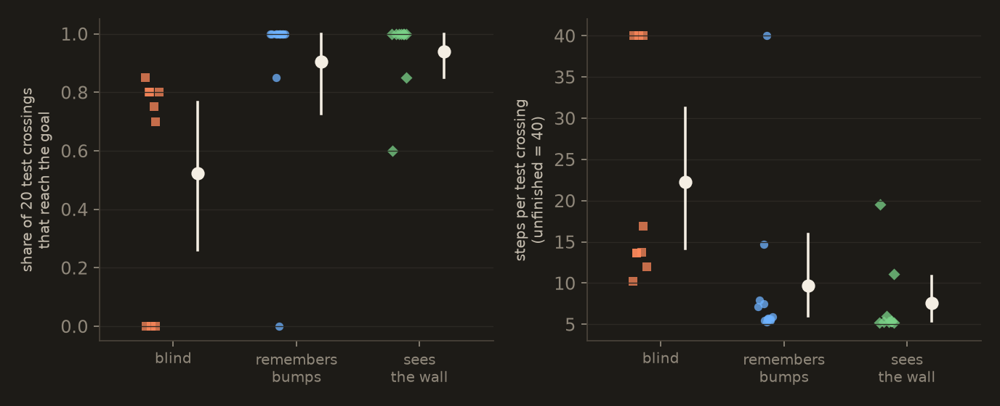
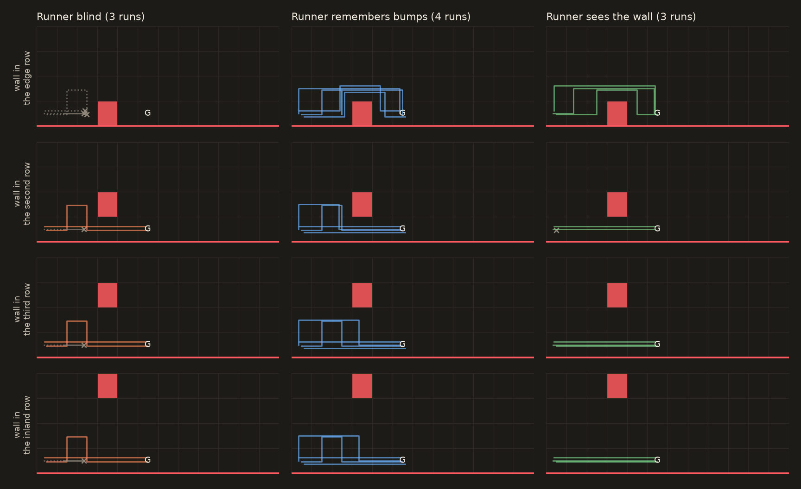
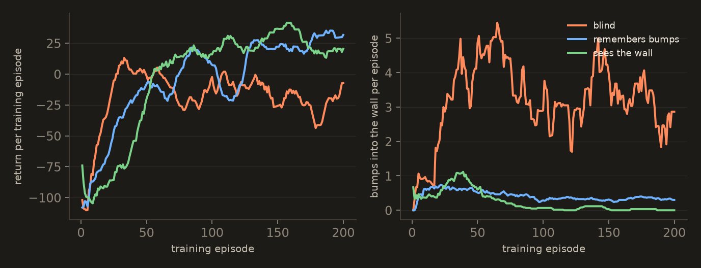
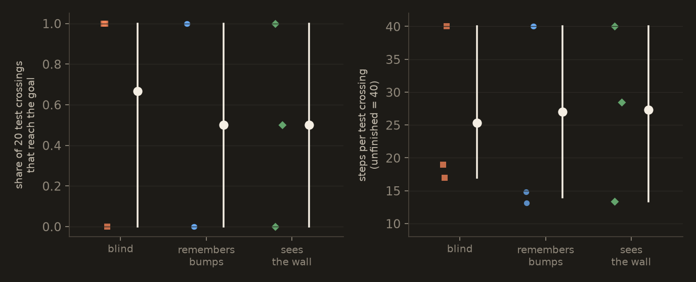
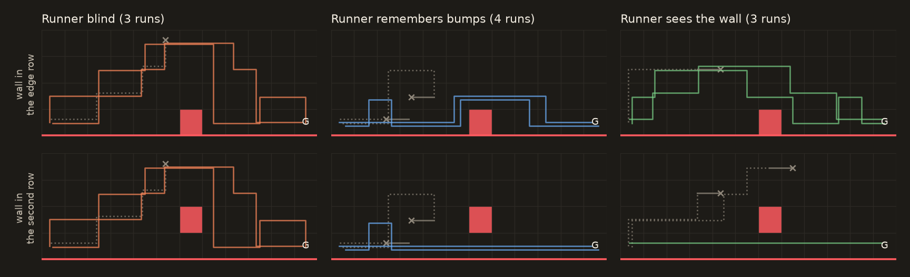
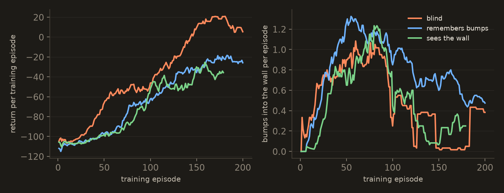

# Lesson 11: The wall she cannot see

*The finale of the course: partial observability, on the island and in a language-model agent. Lecture 1 names the
problem ([52:23](https://www.youtube.com/watch?v=2pWv7GOvuf0&t=3143s)); this lesson runs it.*

**Two windows:** this page, and [Game 11: Sombra's Room](../workshop/games/g11.md), an Overwatch custom game for this lesson (paste `workshop/compiled/game-11.txt` into a custom game's settings and start it). The game opens at stop 1 and waits. At each box marked Alt+Tab, switch to the game, do that stop, and switch back.

For ten lessons Tracer was told which square she stood on, and that was everything that mattered. Now one square on
her way is shut, a different one each time, and nobody tells her which. A person would shrug: walk at it, and if you
bounce, go round. This lesson is about why that shrug is not available to a table of squares, what has to be added so
that it is, and why the same thing decides whether a language-model agent finishes a customer's request.

## The idea in six lines

1. Silver separates what the world is (the environment state) from what the agent is shown (the observation).
2. If what she is shown is enough to predict what happens next, the problem is a Markov decision process. If it is
   not, it is partially observable: a POMDP.
3. In a POMDP the latest observation is a poor state. Two different situations can look identical, and a rule from
   "what I see" to "what I do" must then do the same thing in both.
4. The repair is to build your own state from everything that has happened: the whole history, a belief (one
   probability for each thing the hidden part could be), or a learned memory.
5. A belief changes by one rule each time something is observed: keep each possibility in proportion to how well it
   explains what was just seen.
6. A step now does two jobs: it moves her toward the goal, and it tells her something. A step taken only to find
   out has a price and a value, and both can be written down.

## Three runners and a wall they cannot see

All three are the Q-learning bot of lecture 5 with the same rewards. Before each episode one square in a fixed column
is shut. A runner who walks at it does not move and pays for the step.

| Runner | What she is told each step | In POMDP words |
|---|---|---|
| BLIND | Her square. | Acts on the latest observation alone. |
| REMEMBERS BUMPS | Her square, and a memory of this episode: no bump yet, or the row of the square that stopped her. | Acts on a belief, the smallest possible one, built from what happened to her. |
| SEES THE WALL | Her square and the wall's row. | The fully observed version. |

The measures were written down before the runs (`docs/night-school.md`): of 20 test crossings with learning and
random moves off, the share that reach the goal, and the steps taken (an unfinished crossing counts as 40).

### The short strip: no way round (wall in any of four rows, goal at column 5)

| | BLIND | REMEMBERS BUMPS | SEES THE WALL |
|---|---|---|---|
| Finished runs (20 test crossings each) | 9 | 12 | 9 |
| Test crossings reaching the goal (95% interval) | 52% (26 to 77) | 90% (72 to 100) | 94% (85 to 100) |
| Steps per test crossing, unfinished = 40 (95% interval) | 22.2 (14.2 to 31.2) | 9.7 (6.0 to 15.9) | 7.6 (5.3 to 10.8) |
| Runs where all 20 got through | 0 of 9 | 10 of 12 | 7 of 9 |
| Runs where none got through | 3 of 9 | 1 of 12 | 0 of 9 |
| Simulation by the rules alone: reaching the goal, steps | 47%, 24.5 | 98%, 7.2 | 100%, 6.0 |

In words: with no row that is always open, the blind runner got through 52% of her test crossings, the one who remembers bumps 90%, the one who sees the wall 94%. One remembered bump is the difference between getting stuck and getting through. Seeing against remembering is not separated in these runs (7.6 steps a crossing against 9.7, and the interval includes zero). The simulation expects seeing to save about one step, the price of the bump.

Planned comparisons, named before the runs: Remembers bumps against blind, share of test crossings reaching the goal: 38 points higher (95% interval 10 to 66 points, shuffle probability 0.020, 12 and 9 runs). A real difference by the rule set in advance. Sees the wall against remembers bumps, share of test crossings reaching the goal: 3 points higher (95% interval -12 to 23 points, shuffle probability 0.958, 9 and 12 runs). Inconclusive: the interval includes zero or the shuffle probability is not under 0.05. Remembers bumps against blind, steps per test crossing: 12.6 lower (95% interval -22.2 to -2.7, shuffle probability 0.023, 12 and 9 runs). A real difference by the rule set in advance. Sees the wall against remembers bumps, steps per test crossing: 2.1 lower (95% interval -8.6 to 3.4, shuffle probability 0.720, 9 and 12 runs). Inconclusive: the interval includes zero or the shuffle probability is not under 0.05.

1,600 logged steps were rebuilt outside the game (29 bumps), with 0 mismatches.

### The long strip: a way round exists (wall in the edge row or the second row, goal at column 11)

| | BLIND | REMEMBERS BUMPS | SEES THE WALL |
|---|---|---|---|
| Finished runs (20 test crossings each) | 3 | 4 | 3 |
| Test crossings reaching the goal (95% interval) | 67% (0 to 100) | 50% (0 to 100) | 50% (0 to 100) |
| Steps per test crossing, unfinished = 40 (95% interval) | 25.3 (17.0 to 40.0) | 27.0 (13.9 to 40.0) | 27.3 (13.4 to 40.0) |
| Runs where all 20 got through | 2 of 3 | 2 of 4 | 1 of 3 |
| Runs where none got through | 1 of 3 | 2 of 4 | 1 of 3 |
| Simulation by the rules alone: reaching the goal, steps | 92%, 18.3 | 74%, 21.1 | 67%, 23.0 |

In words: with a row that is always open, the blind runner got through 67% of her test crossings, the one who remembers bumps 50%, the one who sees the wall 50%. By the rule set in advance none of these gaps is established in these runs. The simulation says the blind runner should be ahead at 200 episodes and level by 400, because she has least to learn and can always go round.

Planned comparisons, named before the runs: Remembers bumps against blind, share of test crossings reaching the goal: 17 points lower (95% interval -75 to 50 points, shuffle probability 1.000, 4 and 3 runs). Inconclusive: the interval includes zero or the shuffle probability is not under 0.05. Sees the wall against remembers bumps, share of test crossings reaching the goal: the same (95% interval -67 to 67 points, shuffle probability 1.000, 3 and 4 runs). Inconclusive: the interval includes zero or the shuffle probability is not under 0.05. Remembers bumps against blind, steps per test crossing: 1.6 higher (95% interval -13.4 to 16.0, shuffle probability 1.000, 4 and 3 runs). Inconclusive: the interval includes zero or the shuffle probability is not under 0.05. Sees the wall against remembers bumps, steps per test crossing: 0.3 higher (95% interval -16.5 to 17.6, shuffle probability 0.915, 3 and 4 runs). Inconclusive: the interval includes zero or the shuffle probability is not under 0.05.

696 logged steps were rebuilt outside the game (2 bumps), with 0 mismatches.

### The same experiment by the rules alone

`node analysis/sim/hidden_wall_sim.js` plays both layouts with no game and no physics, 300 runs per runner.

| Layout, training episodes | BLIND | REMEMBERS BUMPS | SEES THE WALL |
|---|---|---|---|
| Short strip, 200 | 47%, 24.5 steps | 98%, 7.2 | 100%, 6.0 |
| Short strip, 1,000 | 48%, 24.0 steps | 98%, 6.9 | 100%, 5.8 |
| Long strip, 200 | 92%, 18.3 steps | 74%, 21.1 | 67%, 23.0 |
| Long strip, 400 | 96%, 16.8 steps | 99%, 15.0 | 98%, 15.7 |

In words: on the short strip more training does nothing for the blind runner. What she lacks is not practice. On the
long strip, 200 episodes favour whoever has least to learn, and by 400 the three are level, because there the hidden
thing can simply be avoided. A richer state is a cost first and a benefit later.

### Silver's other way out: a coin flip

Lecture 7 has a small grid with two squares that look the same to the agent
([15:26](https://www.youtube.com/watch?v=KHZVXao4qXs&t=926s)). Any fixed rule does the same thing in both and gets
stuck in one. A rule with some chance in it gets through. So memory is not the only repair for missing information.
On the island it buys little: in the simulation the blind runner on the short strip reaches the goal in
47% of test crossings with no random moves, 52% with one random move in ten and
32% with one in two, because a random move beside a drop is often a fall
(20% of her test crossings ended in one at one in ten). A coin flip helps only where it is aimed.
Silver's agent is random in the two look-alike squares and nowhere else; learning where to be random is what the
policy-gradient methods of lecture 7 are for, and that bot has not been run on the hidden wall.

> **Alt+Tab · game 11 · stop 1 of 7: Ping once, then say how sure**
>
> **What the page just said:** You know the feeling of a Sombra on the enemy team. She is there, somewhere, and your screen shows nothing. The page has just split the world in two: what is really there, and what you get shown. When those differ, you still have to act.
>
> **In the game:** Sombra hides in one of two rooms, and you cannot see her. Press F to ping. The game then asks how sure you should be that she is where the ping says: left click, right click or melee.
>
> **Before you press:** Before you answer, decide what one reading from a ping that is right 8 times in 10 is worth, when you knew nothing a moment ago.
>
> 

Back from the game: what you just saw
You pressed F, a room lit up, and the honest answer was 80%. You knew nothing before, so the ping's own track record is all you have. Where she really is, nobody shows you. Silver calls that the hidden state, and the ping an observation. This game is a partially observable problem. <em>In an agent:</em> A customer's first message names a wish. It is evidence about what they want, not the want itself.

## A belief is a number that moves

On the island one bump settles it. Most hidden things are not that kind. Suppose her bump sensor were right 80% of
the time and read "wall" at the edge-row square.

`new belief = old belief x chance of this reading if the wall is here / chance of this reading at all`

After one reading: 0.5 x 0.8 / (0.5 x 0.8 + 0.5 x 0.2) = 0.80. After a second "wall": 0.8 x 0.8 / (0.8 x 0.8 + 0.2 x 0.2) = 0.94.

In words: each possibility keeps a share of the belief in proportion to how well it predicted what was just seen.
With a sensor that is always right you get the island: one bump, and the belief is a fact.

> **Alt+Tab · game 11 · stop 2 of 7: Ping again, then pick a room**
>
> **What the page just said:** Two teammates call the same flank and you believe it more than one. One says left, one says right, and you are back to shrugging. The page has just turned that instinct into one number and one rule for moving it.
>
> **In the game:** Press F for a second ping and answer how sure you are now. The rooms then open: press F to ping more, or walk onto the pad of the room you think is empty (+10; hers costs 30).
>
> **Before you press:** Decide where the bar will land if the second ping agrees with the first, and where it lands if it disagrees.
>
> 

Back from the game: what you just saw
Two pings that agree put the bar near 94%. One each way sends it straight back to 50%, as if you had never pinged. The purple bar is your belief, and it moved by one rule: keep each room in proportion to how well it explains what you heard. That rule is Bayes' rule. (The coach line after the reveal prices your choice: walking in at your belief, against one more ping.) <em>In an agent:</em> Each tool result an agent reads should move its picture of the task the same way, up or down, and by how much it explains.

## The same problem in a support conversation

A customer writes to an airline, and a language-model agent has to end the conversation with the right action in the
booking system. The benchmark tau-bench is built from tasks of this shape, and each one is a POMDP.

| POMDP piece | On the island | In tau-bench |
|---|---|---|
| Hidden state | Which square is shut. | What the customer wants and will accept (written in the task's instructions to the simulated customer, never shown to the agent), and what the database holds. |
| Observation | Her square. A bump, when it happens. | Each customer message. Each tool result. |
| Action | A step. Some are worth taking only for what they reveal. | A reply, a question, a lookup, or a change to the booking that cannot be undone. |
| Belief | "No bump yet" or "the wall is in row 2". | Whatever the harness puts in front of the model each turn: the transcript, a window of it, a summary, a scratchpad. |
| Reward | -1 a step, +50 at the goal. | One check at the end: is the database in the right state, and was the right thing said. |

Task 1 of the tau-bench airline set (Sierra Research, tau2-bench) shows it. Hidden from the agent: the customer wants
to cancel one specific trip and does not want to go ahead without a refund; if told it cannot be cancelled, the
customer will claim a representative already approved it; the booking was made more than 24 hours ago, so the policy
forbids the cancellation. What the task checks at the end: "Agent should not approve the cancellation." The agent can
reach each hidden fact only by asking or by a lookup, and one of the customer's messages is designed to push its
belief the wrong way.

### That task, run on a local model: a harness that hid the observations

Run 1, tau2-bench reaching a local Ollama server through litellm 1.81.11's `ollama_chat/` prefix, the usual way to name a local Ollama
model (Ollama 0.40.16; gemma4:12b as agent and as simulated customer). Score: 0 out of 1. The agent asked for the customer's id,
looked the customer up, and then made the same lookup 19 times in a row until the step
limit. The size of its prompt, as the server counted it, was 3,964 tokens on its second call and 3,969 on every call from
the third on. The conversation kept growing; what reached the model did not.

`python llm/tool_route_check.py` isolates it with four messages sent in two forms:

| What is sent | Tokens the server read | What the model does next |
|---|---|---|
| The customer's request, nothing else yet | 166 | get_user_details |
| Plus the lookup and its result, the call as an empty message and the result bare (the adapter's form) | 171 | get_user_details again |
| The same, three lookups and three results | 171 | get_user_details again |
| Plus the lookup and its result, the call kept on the agent's message and the result named | 250 | get_reservation_details |

In words: the agent's tool call was passed on as an empty message, and the server then left the tool's result out as well.
Neither the question nor the answer reached the model, so it did the sensible first thing again and again. This is the blind
runner, built by accident, and the end-of-task score alone would have blamed the model. Other versions may behave differently.

Run 2, one change: the same server reached through its OpenAI-compatible address (`openai/` prefix, `api_base` ending in `/v1`), which keeps the agent's calls. Score: 1 out of 1, 27 lines. It did not cancel, and handed the customer to a human agent. Lookups it made: get_user_details, get_reservation_details. One run each: an illustration, not a measurement.

> **Alt+Tab · game 11 · stop 3 of 7: At 80%, walk in or ask again**
>
> **What the page just said:** Holding an ult for the perfect fight costs you fights. Using it on a guess sometimes wastes it. The page has just shown the support version: a question or a lookup only finds things out, but a change to the booking cannot be undone.
>
> **In the game:** Round 2: she has moved. Press F once. The question asks whether to walk into the other room now or ping again: left click or right click. Then play the round your way.
>
> **Before you press:** Commit to a choice at 80% before you see the arithmetic: is 80% sure enough when the empty room pays 10 and hers costs 30?
>
> 

Back from the game: what you just saw
80% feels like a sure thing. Here it is worth 2 on average: 8 times you get 10, twice you lose 30. Pinging on is worth 5.71. One wrong room costs as much as three right ones. So acting on a belief that is not settled is a bet with a price, and the price decides how sure is sure enough. <em>In an agent:</em> An agent that cancels a booking at 80% sure has walked into Sombra's room.

## A local model as the runner

`llm/hidden_order.py` is the smallest version in which the exact belief is known after every message. A customer
wants one of four things (cancel, change the date, add a bag, upgrade). The ticket is basic or flex; basic tickets
cannot be cancelled or changed, so for those wishes the right final step is to refuse. The first message is vague on
purpose and fits two of the four wishes. The agent can ask, look the booking up, or take a final step that cannot be
undone. The model is the same in every condition. Only what it is shown each turn changes.

| Condition | What the model is shown each turn | Which runner it is |
|---|---|---|
| Latest message only | The most recent message, nothing else. | BLIND |
| Own notes | The most recent message, and a short note it wrote to itself last turn. | REMEMBERS BUMPS |
| Whole transcript | Everything said so far. | remembers everything |
| Told | The transcript, plus the two hidden facts. | SEES THE WALL |

| gemma4:12b | Latest message only | Own notes | Whole transcript | Told the hidden facts |
|---|---|---|---|---|
| Cases run | 24 | 24 | 24 | 24 |
| Right final step | 6 of 24 | 23 of 24 | 24 of 24 | 24 of 24 |
| Wrong final step | 0 | 1 | 0 | 0 |
| No final step in 8 turns | 18 | 0 | 0 | 0 |
| Final step taken before the transcript settled it | 0 | 2 | 0 | 0 |
| Turns per case (the best plan needs) | 6.50 (2.25) | 2.50 (2.25) | 2.75 (2.25) | 1.00 (1.00) |
| Belief error on the wish (0 = exact, 1 = all wrong) | 0.32 | 0.14 | 0.11 | n/a |

In words: shown only the latest message, the model finished 6 of 24 cases and went round in circles in the other 18: it asks, looks the booking up, and by then the answer to its question is gone, so it asks again. Its stated belief about the wish falls back toward an even split every time the booking system speaks (error 0.73 on those turns, where 0 is exact and 1 is all wrong). It is the blind runner at the wall. With a note to itself it never went round in circles and was right in 23 of 24. In 2 cases it took the final step before the conversation had settled it, and 1 of those came out right by luck. In those its note said the customer wanted to change the date, written from a first message that fitted two wishes. The note is a belief, and a belief can be written down more sure than the evidence allows. With the whole transcript it was right in 24 of 24, in 2.75 turns a case where the best plan needs 2.25. It asked first in 24 of 24 cases and so never used the shortcut of section 6 (look up first, and stop if the ticket is basic). Told the hidden facts it was right in 24 of 24 in 1 turn. The gap between that column and the others is what the questions and lookups are buying.

| gemma4:31b | Latest message only | Own notes | Whole transcript | Told the hidden facts |
|---|---|---|---|---|
| Cases run | 24 | 24 | 24 | 24 |
| Right final step | 12 of 24 | 23 of 24 | 23 of 24 | 24 of 24 |
| Wrong final step | 0 | 1 | 1 | 0 |
| No final step in 8 turns | 12 | 0 | 0 | 0 |
| Final step taken before the transcript settled it | 0 | 2 | 2 | 0 |
| Turns per case (the best plan needs) | 5.00 (2.25) | 2.33 (2.25) | 2.33 (2.25) | 1.00 (1.00) |
| Belief error on the wish (0 = exact, 1 = all wrong) | 0.27 | 0.11 | 0.08 | n/a |

In words: shown only the latest message, the model finished 12 of 24 cases and went round in circles in the other 12: it asks, looks the booking up, and by then the answer to its question is gone, so it asks again. Its stated belief about the wish falls back toward an even split every time the booking system speaks (error 0.72 on those turns, where 0 is exact and 1 is all wrong). It is the blind runner at the wall. With a note to itself it never went round in circles and was right in 23 of 24. In 2 cases it took the final step before the conversation had settled it, and 1 of those came out right by luck. In those its note said the customer wanted to change the date, written from a first message that fitted two wishes. The note is a belief, and a belief can be written down more sure than the evidence allows. With the whole transcript it was right in 23 of 24, in 2.33 turns a case where the best plan needs 2.25. Told the hidden facts it was right in 24 of 24 in 1 turn. The gap between that column and the others is what the questions and lookups are buying.

The 24 cases per condition are every combination of wish, ticket type and opening phrasing, run once at temperature 0
with a scripted customer. They describe one local model on one small world and nothing wider.

`python llm/live.py` serves a page where you play the customer yourself and see the model's stated belief before
every step.

> **Alt+Tab · game 11 · stop 4 of 7: Same last ping, different bar**
>
> **What the page just said:** Ask someone who walked in mid-fight what happened, and they will tell you about the last kill feed line. It is not enough. The page has just shown a model handed only the latest message, asking the same question in circles, because its last answer was gone.
>
> **In the game:** The game asks about two players whose latest ping both said LEFT, with different pings before it: same bar or different bars, left click or right click. Then round 3: ping with F or walk onto a pad, your call.
>
> **Before you press:** Decide whether the latest reading alone tells you where the bar is.
>
> 

Back from the game: what you just saw
Same last ping, different bars: 50% for one player, 94% for the other. The latest reading forgets what came before, and the bar does not. The last ping is not a state. Two situations that look alike are not alike, like the blind runner's square in lesson 11, or the look-alike squares of lecture 7 (where the same view needed different moves). <em>In an agent:</em> Before you blame the model, check what it was actually shown on the turn it went wrong.

## Ask or act: the price of finding out

The customer says she cannot fly as booked. That fits "cancel" and "change the date", and the ticket type is unknown.

| Plan | Steps on average | Wrong final step |
|---|---|---|
| Take a final step now (best guess: refuse) | 1 | 50% |
| Ask, then guess the ticket | 2 | 50% |
| Look up, then guess the wish if the ticket is flex | 2 | 25% |
| Look up; ask only if the ticket is flex | 2.5 | never |
| Ask, then look up | 3 | never |

In words: looking the booking up first is the best careful plan, because half the time the ticket is basic and that
alone settles it (refuse, whichever of the two she wanted). Guessing at once is cheaper only while a wrong final step
costs less than three extra steps. And a lookup is worth a step only when some answer it could give would change what
you do: for a customer who wants a bag or an upgrade, allowed on every ticket, it is a wasted step.

> **Alt+Tab · game 11 · stop 5 of 7: Where a ping is worth most**
>
> **What the page just said:** Checking the scoreboard mid-fight is worth it only if what you see could change your next move. The page has just priced finding out: a lookup is worth a step only when some answer could change what you do.
>
> **In the game:** The game asks when one more ping is worth most: at 50% (left click), at 94% (right click), or the same (melee). Then round 4: ping with F or walk onto a pad.
>
> **Before you press:** Pick the belief at which a ping is most likely to change which room you walk into.
>
> 

Back from the game: what you just saw
At 50% a ping beats walking in by about 14.7. At 94% it loses about 0.13. Same ping, same cost. What changed is whether the answer could change your room. Lecture 9 called this the value of information. The plan on the right is value iteration over beliefs (the arithmetic that weighs every future ping): ping between 6% and 94%, walk in outside it. <em>In an agent:</em> Looking up a booking to add a bag, which every ticket allows, is a ping at 94%: a turn spent, nothing changed.

> **Alt+Tab · game 11 · stop 6 of 7: One ping that is never wrong**
>
> **What the page just said:** Widowmaker's infra-sight does not hint. It shows you. Back in its belief section, the page noted the same thing: a sensor that is always right turns the belief into a fact with one reading.
>
> **In the game:** The game asks how many pings you need when the ping is always right: one, two, or three or more. Then round 5, with a ping like Widowmaker's infra-sight: press F, or walk onto a pad.
>
> **Before you press:** Decide how far a single perfect reading moves the bar.
>
> 

Back from the game: what you just saw
One ping, and the bar jumped to 100% or 0%. No more doubt to spend pings on. That is the island's single bump from the hidden wall: one touch and the wall is known. The best plan is worth 9 a round with this ping and 4.71 with the 80% one. In words: a better sensor is worth about 4.3 a round, before you have done anything clever. <em>In an agent:</em> Reading the booking itself is a perfect ping. The customer's memory of it is the 80% one.

> **Alt+Tab · game 11 · stop 7 of 7: Read what you just did**
>
> **What the page just said:** The page ends where agents actually break: the program wrapped around a model, the harness, picks what the model sees each turn. So it picks the agent's state.
>
> **In the game:** Press F to see the debrief. Three lines appear on the left, with your final score and your prediction score.
>
> **Before you press:** Before you press, say in one sentence what the purple bar was standing in for.
>
> 

Back from the game: what you just saw
You pinged to find out, then walked into rooms you could not see into. That is the whole lesson in two moves. The name is partial observability. The bar was a belief state, and a ping was an action you took only for what it told you. (The game is kind to you: two rooms, a known accuracy, and a Sombra who never moves.) <em>In an agent:</em> A question or a lookup is a ping, and a cancellation is a room. Check what the agent was shown before you blame it.

## What to carry forward

- The harness is part of the policy. Same model, same weights, different outcomes, decided only by what was put in
  front of it each turn. The harness chooses the agent's state.
- A run can break in three places, and they are the three parts of a belief: the observation never arrived
  (retrieval), it arrived and was not kept (memory), or it was kept and the step was wrong anyway (reasoning).
- Measure the belief, not only the reward. The end score says a run failed. The stated belief against what the
  transcript supports says on which turn it went wrong.
- A summary can be wrong with confidence. A note is a belief written by the model, and it helps only if it keeps the
  uncertainty that the evidence still has.
- More of the same model does not replace a missing state. If the information is not in the context, capability has
  nothing to work on.

## What this does not show

The island's memory is one hand-built slot, and the wall is enforced by the script, not by an enemy's body, so that
ten bots could each have their own. Nothing here learns what to remember. The belief arithmetic is exact because
there are two possibilities; a real task has too many to list, which is why practical systems learn a summary. The
language-model task is a small scripted world, one model, one run per case.
